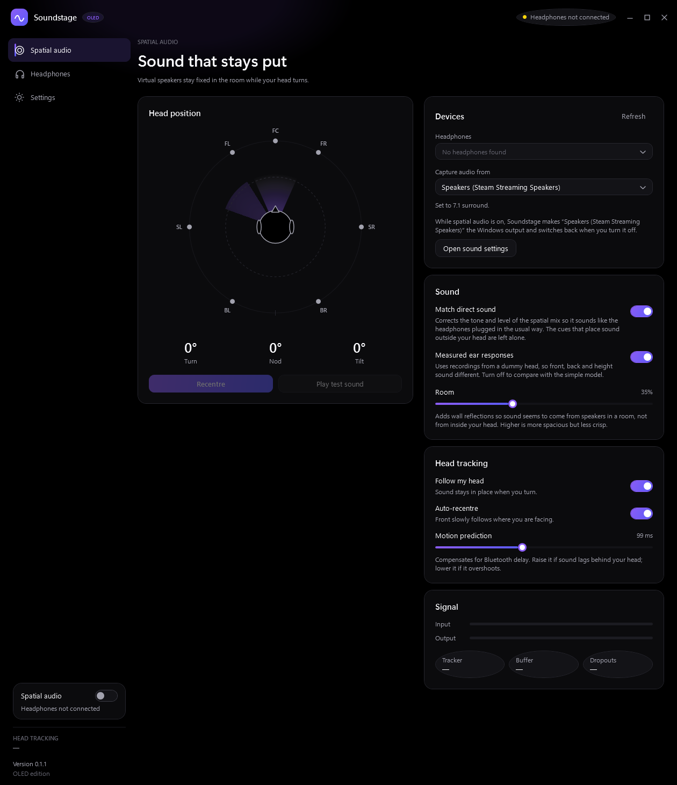
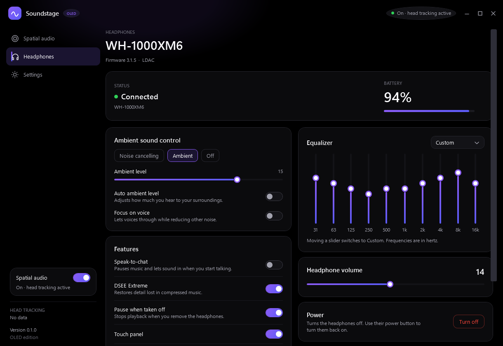
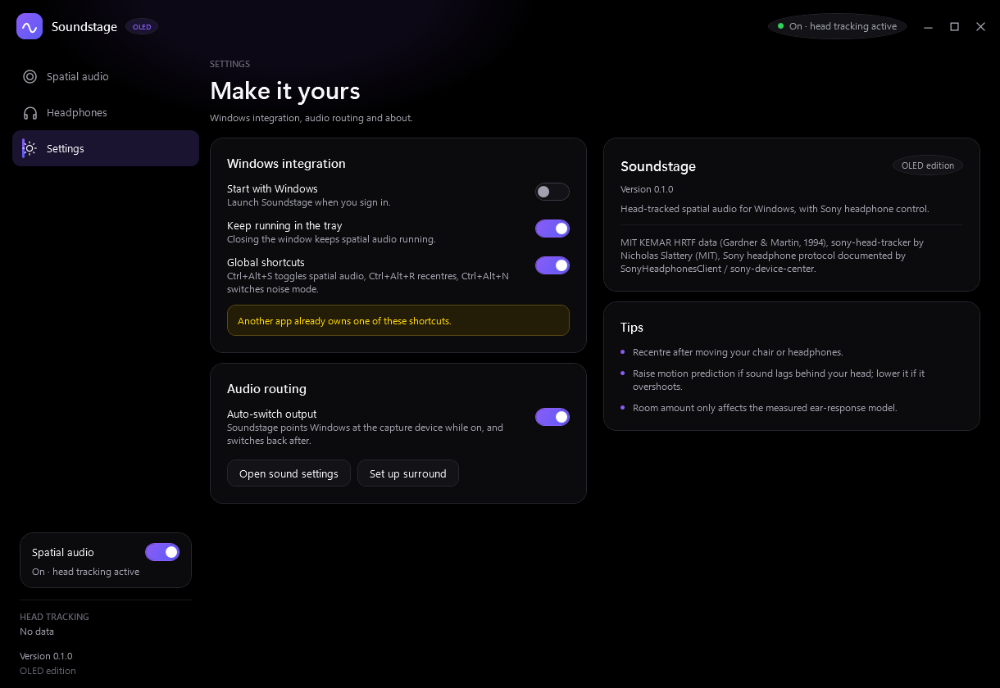

# Soundstage

Head-tracked spatial audio on Windows for Sony headphones that expose the
Android Head Tracker sensor (developed on the WH-1000XM6), plus a full control
panel for the headphones themselves.

Windows has no head-tracked spatial audio of its own. Soundstage captures what
your apps play, places it on virtual speakers around you, and keeps those
speakers fixed in the room as you turn your head.

> Unofficial. Not affiliated with, endorsed by, or supported by Sony.



## Install

**[Download `Soundstage-Setup.msi`](https://github.com/NithishRamamourthy/Soundstage/releases/latest)** and double-click it.

Everything is inside the installer, including the .NET runtime and the head
tracker. Nothing is downloaded during setup and nothing else has to be installed
first, on a fresh Windows 11 machine or on one with no developer tools at all.

- Installs per user into `%LocalAppData%\Programs\Soundstage`, so it needs no
  administrator rights and nothing is installed machine-wide.
- Adds a Start Menu shortcut. To also get a desktop shortcut, run
  `msiexec /i Soundstage-Setup.msi DESKTOP_SHORTCUT=1` (or tick the option in
  the installer).
- Uninstall from **Settings → Apps → Installed apps → Soundstage**.

There is also a portable `Soundstage.exe` in the same release: no installer,
just run it from any folder. It carries the head tracker inside itself and
unpacks it to `%LocalAppData%\Soundstage\tools` on first use.

Requirements: Windows 11 x64, a Bluetooth-connected supported Sony headphone,
and a virtual playback device for apps to play into (see below).

## What it does

**Spatial audio**

- Live head tracking, driven by the headphone's own motion sensor.
- **Match direct sound**: corrects the tone and level of the spatial mix to within
  about 1 dB of plain playback, so switching spatial audio on does not change how
  your music sounds — only where it comes from.
- Stereo, 5.1 and 7.1 input, rendered binaurally with measured ear responses
  (MIT KEMAR dummy head).
- Adjustable room simulation, motion prediction, recentre, per-speaker test
  sounds.
- Automatically makes the virtual device the Windows output while spatial audio
  is on, and switches back when you turn it off.

**Headphone controls** (written against a WH-1000XM6)

- Battery, firmware, codec.
- Noise cancelling / ambient / off, with ambient level, auto ambient level and
  focus on voice.
- Ten-band equaliser with presets.
- Speak-to-chat, DSEE Extreme, pause when taken off, touch panel, connection
  priority, auto power off, headphone volume, power off.



**Desktop app**

- OLED-black interface, custom title bar, dark mode regardless of system theme.
- Tray icon, close-to-tray, and global hotkeys: `Ctrl+Alt+S` toggle spatial
  audio, `Ctrl+Alt+R` recentre, `Ctrl+Alt+N` show the window.



## Using it

1. Pair and connect the headphones.
2. In Soundstage, choose your headphones and the virtual device to capture.
3. In Windows sound settings, make that virtual device the output device.
4. Turn on **Spatial audio**.

For real surround positions in games and films, set the virtual device to 5.1
or 7.1. If the device supports it, Soundstage shows a **Set up surround** button
that opens the Windows Sound panel: select the device, press Configure and pick
the layout. Stereo sources are placed on two virtual front speakers.

If the head position does not move, press **Fix tracker**. Windows sometimes
leaves the headphone's sensor inactive after a restart; the fix re-activates it
and shows one administrator prompt.

## What you need

- **Windows 11, x64.**
- **A virtual playback device** for apps to play into, for example
  *Steam Streaming Speakers* (installed with Steam) or VB-CABLE. Soundstage
  captures that device with WASAPI loopback and plays the rendered result to
  your headphones.
- **Nothing else.** The .NET runtime and
  [sony-head-tracker](https://github.com/NicholasSlattery/sony-head-tracker)
  (MIT, v2.2.0), which reads the headphone's motion sensor, are both bundled.
  If you want to use your own build of the tracker instead, drop
  `sony-head-tracker.exe` next to `Soundstage.exe` and that copy is used first.

## How it works

```
apps -> virtual playback device -> loopback capture -> binaural renderer -> headphones
                                                            ^
headphone motion sensor -> sony-head-tracker (UDP JSON) ----+
```

- `src/Soundstage.Engine` - WASAPI capture and playback, the binaural renderer,
  head-pose smoothing and prediction, the Sony control protocol. No third-party
  dependencies.
- `src/Soundstage.App` - the WPF app (`net10.0-windows`).
- `src/Soundstage.Cli` - command-line runner for testing
  (`soundstage-cli --help`, `--selftest`, `--demo`).

## Build from source

Requires the [.NET 10 SDK](https://dotnet.microsoft.com/download).

```
dotnet build Soundstage.slnx -c Release
src\Soundstage.App\bin\Release\net10.0-windows\Soundstage.exe
```

Single-file portable build:

```
dotnet publish src\Soundstage.App\Soundstage.App.csproj -c Release -r win-x64 ^
  --self-contained true -p:PublishSingleFile=true ^
  -p:IncludeNativeLibrariesForSelfExtract=true -p:EnableCompressionInSingleFile=true ^
  -o dist\app
```

MSI installer (WiX Toolset 5, free and open source):

```
dotnet tool install --global wix --version 5.0.2
wix build installer\Soundstage.wxs -o dist\Soundstage-Setup.msi -arch x64 -b .
```

## Limitations

- The ear responses are from a dummy head, not your own ears, so how convincing
  front/back and height are varies from person to person.
- Headphone support is written against the WH-1000XM6 protocol. Other Sony
  models that share the same control channel mostly work; unusual ones may show
  missing or greyed-out controls.
- Not built yet: multipoint device switching, touch-control customisation,
  firmware updates.

## Credits

See [NOTICE.md](NOTICE.md) for full attributions.

- HRTF data: Bill Gardner and Keith Martin, "HRTF Measurements of a KEMAR
  Dummy-Head Microphone", MIT Media Lab, 1994. Used with citation, as its terms
  require.
- Head-tracker sensor access: [sony-head-tracker](https://github.com/NicholasSlattery/sony-head-tracker)
  by Nicholas Slattery, MIT License. Version 2.2.0 is bundled, unmodified, and
  its license text ships with it.
- Control protocol documentation: [SonyHeadphonesClient](https://github.com/mos9527/SonyHeadphonesClient)
  and [sony-device-center](https://github.com/marconvcm/sony-device-center)
  (MIT). No code from either is included.
- Structural head model: C. P. Brown and R. O. Duda, "A structural model for
  binaural sound synthesis", IEEE Transactions on Speech and Audio Processing,
  1998.

## License

The Soundstage source in this repository is released under the MIT License; see
[LICENSE](LICENSE). Third-party data and names remain under their own terms, as
described in [NOTICE.md](NOTICE.md). Sony, WH-1000XM6 and related marks belong
to Sony Group Corporation.
